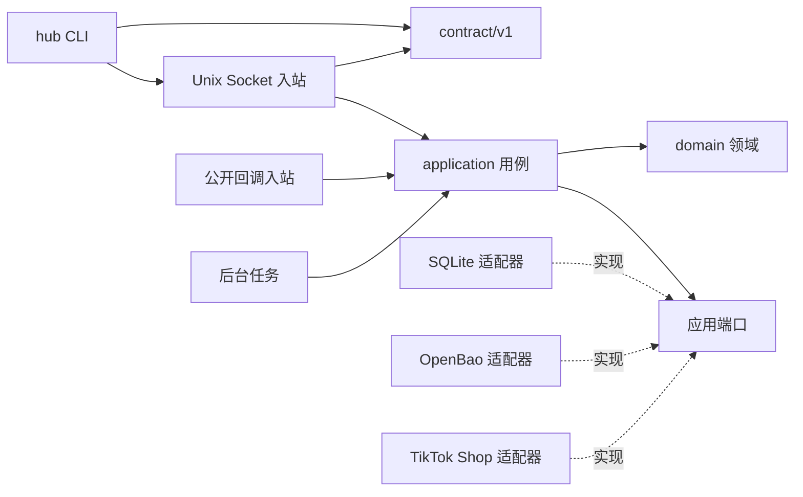
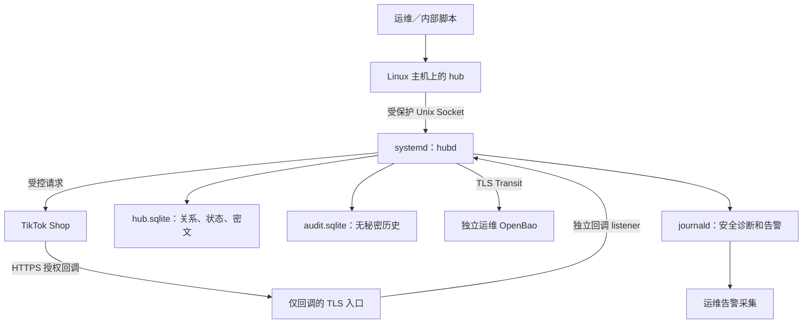
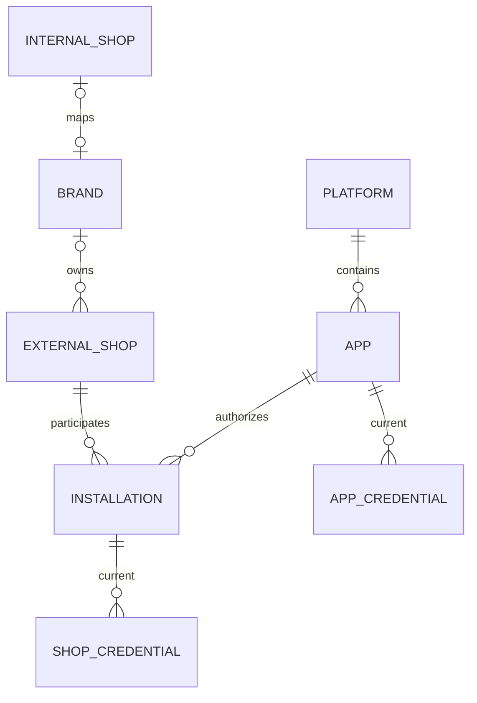

# 首期架构契约

供架构、CLI、平台接入及后续 Epic 构建者共同引用。产品基线以 [PRD](../../prds/prd-third-party-api-key-hub-2026-10-08/prd.md) 为准。用户于 2026-10-08 回复“全部采用”，接受 [R-1 至 R-10](recommended-decisions.md) 及其架构规则；`[ADOPTED]` 表示已确认选择，原草案假设已由本次决定取代。技术核实依据见 [technology-evidence.md](technology-evidence.md)，接受方案不代表实现、安装、性能验收或平台联调通过。

2026-10-08 用户要求按 Party 审查 PM-01 至 PM-06 全部修订；状态证据、响应扩展和结果保护细化已采用，原 AD 编号及技术选择保留。强制补充见 [凭据状态转换](credential-state.md)、[响应兼容](response-compatibility.md)、[待处置结果保护](pending-results.md)。完整编码设计及实证仍受 Story/SQ 门槛约束。

## Design Paradigm

采用六边形架构的模块化单体：领域与用例定义端口；CLI／本地协议、回调与后台任务调用用例；SQLite、密钥保护和 TikTok 适配器实现出站端口。单个 `hubd` 进程执行全部领域规则；`hub` 为本地主机客户端。命令名是已接受的初始约定。



图中的实线为代码依赖；出站适配器实现端口，`domain` 不依赖 SQL、HTTP、操作系统或具体平台。`cmd/hubd` 是唯一组装根。

## Invariants & Rules

### AD-1 — 共享核心与进程职责

- **Binds:** all，NFR-4、NFR-6。
- **Prevents:** CLI、回调、后台任务分别实现不同的凭据与归属规则。
- **Rule:** [ADOPTED] Go 服务和 CLI 共享领域、适配器及凭据核心。[ADOPTED] 核心运行于单个 `hubd`；CLI 只复用契约、输入验证及安全输出，不直接读写 DB、不直接调用密钥后端、不刷新 Token。所有领域操作进入同一 application 用例；平台及存储细节经端口注入。单节点单实例，第二实例须因排他运行锁失败而退出。

### AD-2 — 状态所有权与变更入口

- **Binds:** FR-1 至 FR-9、Q-6、Q-10。
- **Prevents:** 回调与 CLI 各自创建安装版本，适配器绕过规则更新关系。
- **Rule:** [ADOPTED] application 唯一拥有平台/App、品牌/店铺映射、安装授权、当前凭据与授权会话的变更入口。适配器只返回规范化结果或类型化失败，不写领域库。持久化操作带服务生成的 `operation_id`；可变对象使用 `row_revision` 作状态 CAS，秘密值使用单独的 `generation`（见版本约定）。同 App 下凭据/安装变更还推进 App 聚合 `row_revision`，未知店铺身份的授权兑换也能检查整个 App 的变化；操作日志/任务领取不推进领域对象版本。迁移脚本仅处理 schema，不伪装成业务变更。

### AD-3 — 本地主机身份与权限边界

- **Binds:** FR-11、SM-6、Q-4。
- **Prevents:** 客户端伪造用户名、网络取密、Socket 组成员自动取得管理资格。
- **Rule:** [ADOPTED] 首期取密仅限服务 Linux 主机受控账户。[ADOPTED] 管理协议只监听 `/run/api-key-hub/hub.sock` 的路径型 Unix stream socket，每连接一个请求、禁用连接复用。内核 `SO_PEERCRED` 提供 UID，忽略客户端传入的账户/角色字段；服务核对 root 所有、服务只读的 UID＋账户名白名单和 `read`／`manage` 操作资格。取密调用者须 `read`，变更须 `manage`；可同时授予两者。首期获 `read` 的账户可查询全部满足归属条件的目标，不引入租户或对象级策略，此粒度已随 R-2 确认。每请求及返回明文前重新读取原子替换的策略；策略损坏、账户映射变化或身份无法读取时拒绝。不得缓存长期授权结果。systemd 以 RuntimeDirectory 创建 `hubd:hub-clients 0750` 目录，hubd 创建 `hubd:hub-clients 0660` Socket，客户端无目录写权限；Socket 访问权限只是第一层门槛，不能替代 UID 校验。授权策略存放于另一个 root 所有的只读配置位置，不因 RuntimeDirectory 属于 hubd 而允许服务改权限策略。UID 不允许复用而不更新策略；主机 root 是部署信任边界。

### AD-4 — 唯一关系与凭据归属

- **Binds:** FR-1 至 FR-4、FR-6、NFR-2。
- **Prevents:** 名称充当身份、重复当前授权、跨 App 凭据混用或缺映射取密。
- **Rule:** [ADOPTED] App 本中心标识全局唯一，`(platform, provider_app_id)` 唯一；`(app_id, external_shop_id)` 唯一安装；外部店铺至品牌多对一，品牌/内部店铺双向唯一。凭据必须归属 App 或安装授权，同目标同类型只有一个当前值；替换须显式，冲突整笔拒绝且原状态不变。解除映射不删除凭据，但任一查询须检查完整外部店铺→品牌→内部店铺链。[ADOPTED] 唯一索引、外键和用例校验共同执行这些规则。`external_shop_id` 是本中心全局唯一 ID，平台身份 `(platform, provider_shop_id)` 唯一；适配器只返回平台身份，application 负责同平台跨 App 店铺归并。安装与映射只引用中心 ID；平台 shop ID 及按 App/安装上下文保存的 `shop_cipher` 均不能当中心 ID。

### AD-5 — 一致性门与原子提交

- **Binds:** FR-2 至 FR-9、NFR-2、Q-6、Q-10。
- **Prevents:** 映射解除后旧缓存继续取密、迟到刷新覆盖新授权、跨组件混合读取。
- **Rule:** [ADOPTED] 单进程共享一致性读写门；全部领域变更持写门并在同一 SQLite 事务提交，查询持读门直到完整结果与权限复核完成。线性化点是事务提交或服务完成整份结果复核；在变更完成之后发起的查询必须读到新状态，已在线性化点完成的响应可能稍后被客户端接收。无明文、映射或可用性结果缓存。密钥服务加解密可在门内受超时约束；TikTok 网络调用不得持门。网络完成后在写门内比较操作记录的 App/refresh resource/已知依赖对象 `row_revision` 快照，不匹配不得覆盖当前值；冲突按 `input_invalid` 返回安全的冲突说明，具有外部副作用的结果进入 AD-9 恢复路径。用户管理变更在事务提交前重核当前 manage 资格；尚未兑换的会话若发起账户已失去 manage，禁止兑换。已发起平台请求不能因资格撤销丢弃结果：服务仍保存受保护的待处置结果和审计，但不得替该账户提交领域变更或恢复资格；获授权运维须显式处置。不得在此处盲目重放平台调用。

### AD-6 — 秘密保护与事务边界

- **Binds:** NFR-1、NFR-6、SM-8、Q-9。
- **Prevents:** 明文进入 DB/备份、密钥与密文同库、密钥后端和状态库双写失配。
- **Rule:** [ADOPTED] 生产支持专用密钥管理服务；Vaultwarden 尚未被选作生产后端。[ADOPTED] 首期使用 OpenBao Transit 保护密钥，SQLite 仅保存密文、密钥版本引用和非敏感状态。`SecretProtector.Seal/Open` 由用例调用，生产密钥不得导出或落业务库；当前凭据密文以 purpose=current-credential 绑定目标、类型和 generation，解密后验证；待处置平台结果以 purpose=pending-provider-result 绑定 operation、App、epoch/profile 与依赖快照，两个用途不得互换，规则见 pending-results.md。加密成功之后密文及当前元数据在业务事务原子提交，失败不得替换旧记录。生产无明文降级或明文磁盘/跨请求缓存；OpenBao 不可用时，取密/需加解密的操作整体失败，但不把依赖故障标记为平台失效。TLS 校验 CA/主机身份，AppRole 最小授权；bootstrap SecretID 由 systemd credential 文件供给，不写 unit 字面量、命令参数或生产环境变量。开发/测试只用虚构秘密和隔离后端。

### AD-7 — 可用性由正交字段组成

- **Binds:** FR-6 至 FR-9、SM-4、Q-5、Q-6。
- **Prevents:** 刷新成功解除停用、暂时验证失败覆盖原状态、未知期限被解释为无限期。
- **Rule:** [ADOPTED] 运维确认与平台验证可区分；未知期限经运维确认可用；暂时验证失败标记未完成且保留原可用状态。停用须在重新授权/显式替换之后由运维显式恢复，后台刷新、验证成功、映射恢复均不能自动解除停用。[ADOPTED] 每份当前凭据的版本证据、来源、期限、停用和持久化恢复资格按 [credential-state.md](credential-state.md) 的字段及事件转换表保存。确认/验证只证明其绑定 generation；换值重置旧证据，暂时验证故障只记录尝试而不覆盖同版本确定证据。恢复须具有停用后明确替换/重授权的业务事务证据，刷新递增 generation 不能创建资格；再次停用清空资格。mark-invalid、确认和恢复携带 expected_generation，旧值失效报告不得停用新值，主动 disable 独立表达停用当前目标。恢复仍重查当前有效性、完整映射及管理资格。`expired` 由已知 `expires_at <= now` 判定，不能通过刷新失败推导；验证不确定不恢复已过期/停用值。明确失效也执行停用且留下非敏感原因。

### AD-8 — 完整业务组合与选择

- **Binds:** FR-9、FR-10、SM-5。
- **Prevents:** 自动跨目标选择、部分秘密输出、refresh token 泄入业务查询。
- **Rule:** [ADOPTED] 按品牌、内部店铺或外部店铺解析范围；唯一 App/店铺自动使用，多项须显式指定，所选 App/店铺同时属于请求范围。调用所需 App 凭据和店铺 Token 完整返回，任一必需字段缺失/过期/停用/不可用则整体失败，无部分秘密。仅刷新/管理用的秘密不返回。[ADOPTED] provider profile 唯一定义类型、用途和必需组合。全部解密、绑定复核、有效性及权限检查完成后，服务才序列化完整结果，CLI 完整读取及验证后一次写 stdout；不流式输出秘密，不另设 App 独立明文查询路径。

### AD-9 — 刷新与外部副作用

- **Binds:** FR-7、FR-8、Q-6、Q-7。
- **Prevents:** 多任务同时轮换、过期请求无限等待刷新、旧响应覆盖新值或假定外部 exactly-once。
- **Rule:** [ADOPTED] 支持刷新的凭据自动维护；失败时旧值仍有效且未停用可返，过期/停用后拒绝。[ADOPTED] 取密不触发即时平台刷新，后台按持久化 `next_attempt_at` 调度。App 级和安装级均使用同一维护入口；规范化 `refresh_resource_id` 归属 App 或安装。共享同一远端 grant/refresh secret 的安装必须引用同一 resource，不复制为独立轮换任务；依赖当前值及其新 generation 在同一业务事务更新。所有可能改变远端凭据的兑换/重新授权/刷新共用 application 的 App 级排他协调，直到平台结果安全终结才释放；尚未知道店铺身份也使用 App 范围，首期不缩小。浏览器等待授权阶段不持网络操作门。领取前持久化 operation 和 AD-5 的版本快照；任何可能已有远端副作用但结果未安全保存/提交的故障，包括成功后的 KMS/DB 失败、权限撤销、CAS 冲突及崩溃，都进入待处置/`indeterminate` 路径。启动发现未终结操作时阻止该 App 进一步自动轮换，只有已保护完整结果通过本地条件提交安全终结，或平台复核/受控重新授权明确安全终结，才能解除对应阻塞。安全保存的加密结果只能重试本地条件提交，不能再调用平台；尚未安全保存的秘密不得转明文落盘。只有明确可重试且无不确定副作用的失败才有界退避；受控恢复授权与普通自动轮换区分，仍经同一 App 门。旧值有效性按已核实轮换契约及明确证据复核；KMS/DB 故障本身不是平台失效证据，不宣称旧值一定仍有效。不把 CAS 当远端 exactly-once，不重放未经证明幂等的调用。资源映射、轮换分类与调度参数须由已核实 profile 提供。受保护结果的用途绑定、状态与本地条件提交按 [pending-results.md](pending-results.md)；其完整编码设计由 1.2、隔离交换/重启验证由 1.6 产出，未通过时 2.4/2.5/2.7 不可定稿实施。

### AD-10 — 回调独立边界与持久化幂等

- **Binds:** FR-5、NFR-3、Q-7。
- **Prevents:** 公网 listener 暴露管理/取密、重复兑换或迟到回调覆盖新授权。
- **Rule:** [ADOPTED] 独立回调 mux 仅注册授权回调和无秘密健康入口，不注册任何 Unix 管理路由。CLI 创建持久化授权会话，随机 state 至少 256 bit；DB 保存其哈希、App、发起账户、`authorization_epoch` 和截止时点，不保存明文授权码。同 App 每次新会话推进 epoch，旧会话不得兑换。回调验证会话、发起者当前 manage 资格及平台来源后，通过 AD-9 共用 App 协调领取操作，再捕获 AD-5 的当前对象版本快照；session/operation 唯一约束防重复兑换。待兑换、处理中、已获取加密结果、已提交和结果不确定按 AD-9 恢复；成功结果与安装更新在业务事务提交，重复已提交回调只返回安全完成状态。App/目标不匹配、过期、迟到 epoch 或版本快照冲突不得覆盖。平台身份从已核实接口取得，经 application 映射为 AD-4 的中心店铺 ID；多个授权店铺不自动分配品牌或内部店铺，按完整映射规则限制查询。HTTPS 回调入口和访问日志不得记录 query、授权码或请求/响应体；响应不含任何凭据。state、来源校验、URL 及兑换契约须先核实，不能套用通用 OAuth 作为平台事实。

### AD-11 — 适配器能力与平台证据

- **Binds:** FR-1、FR-5 至 FR-9、NFR-4、Q-7。
- **Prevents:** 将 Creator/Affiliate 接口直接视为 Seller 契约或新增平台修改核心关系。
- **Rule:** [ADOPTED] provider adapter 提供授权发起、兑换、店铺身份解析、可选验证、可选刷新及失败分类；capabilities 明确支持性、秘密用途、必需组合、轮换/安全重试规则。网络地址来自服务受控配置而非客户端输入。未知能力不伪装成功；手工导入可按用户确认规则独立工作，但 TikTok 授权/刷新真实实现 Story 必须先落实目标市场、App 类型、官方版本和受控联调计划。没有已核实 profile 时不得启用真实平台授权/后台刷新。

### AD-12 — 非阻断审计与安全诊断

- **Binds:** FR-12、NFR-1、SM-6、Q-8。
- **Prevents:** 审计故障回滚已成功操作、诊断记录秘密、CLI 冒充账户或审计保留缩水。
- **Rule:** [ADOPTED] 凭据相关操作成功/失败都审计，至少保留一年；审计写入失败告警且不阻断原操作。[ADOPTED] 独立 `audit.sqlite` 和独立连接记录 UTC 时间、内核 UID/解析账户名、actor kind、操作、非敏感目标引用、结果、错误类别、operation_id；后台/回调记录服务 UID 及已知的授权发起账户。application 审计用例统一接收业务结果及 local/callback 入站的身份、权限、schema/体积拒绝事件，边界拒绝不因尚未进入业务用例而跳过；对象无法安全识别时仅记录未知目标，不拷贝原始输入。CLI `audit list` 经本地 manage 资格检索，按时间、操作、目标、结果、operation_id 过滤，分页返回非敏感事件。CLI 本地输入拒绝可尽力提交受限枚举的 client-rejection 事件，由内核身份标为客户端自报；发送失败仍返回原错误并产生安全诊断。服务未收到的连接拒绝由部署的系统事件采集记录，部署验收须验证这个入口；不能将未到达服务的操作谎报为已审计。审计在业务结果确定后尽力写入且有时间上限，不参与业务事务；缺口不得宣称已补写，至少一年保留及定期备份共同覆盖历史。失败向 journald 发结构化白名单告警，健康状态降级并由运维采集规则告警；业务与审计同磁盘故障不承诺无丢失。日志、审计、告警、错误只从非敏感 DTO 白名单构造，禁止直接格式化平台错误、HTTP body、输入、解密对象或密文包。无秘密历史与操作审计共用这一保留规则。

### AD-13 — 唯一协议与 CLI 契约

- **Binds:** FR-6、FR-10、NFR-5、Q-3、Q-5、Q-10。
- **Prevents:** 各命令独自设计字段/退出码、输入秘密出现在参数或缺项脚本进入交互。
- **Rule:** [ADOPTED] 成败 stdout 均 JSON，诊断 stderr，退出码成功 0/失败 1；同一主版本不破坏已有字段/类型/含义；导入支持隐藏交互和 stdin。[ADOPTED] `internal/contract/v1` 唯一拥有 DTO、错误码和内部操作清单，Unix IPC 使用 HTTP/1.1 JSON `/v1/operations`，最大请求 1 MiB，单请求连接及严格 schema。成功查询三组 `identity`、`credentials`、`status`；credentials 按 `app`/`shop` 各含 type/value 列表，status 同 type 对应正整数 `generation`、可用状态、`expiry_known`、`expires_at`（未知为 null），identity 含全部归属稳定标识。失败仅含 `error`、安全 `message`。稳定码为 `input_invalid`、`not_found`、`selection_required`、`mapping_incomplete`、`mapping_mismatch`、`permission_denied`、`credential_missing`、`credential_expired`、`credential_disabled`、`internal_error`；依赖故障映射最后一类。先校验身份/权限，再输入与对象存在性、选择、归属、必需字段、停用、过期、解密与内部故障；未获权限者不披露对象信息。命令语法在 CLI Story 前生成完整 schema/示例/契约测试，服务与 CLI 不另造编码。请求严格性与成功响应的非敏感元数据扩展分别按 [response-compatibility.md](response-compatibility.md)；旧 CLI 校验已知字段并重建输出，不透传未知字段，未知秘密类型/字段仍拒绝。导入 stdin 为一个严格 JSON 对象读至 EOF，缺项直接失败；只有显式 interactive 且 TTY 可用才隐藏读取，恢复 TTY 并处理取消，秘密不得用命令参数输入。命令结果及诊断不回传导入值。

### AD-14 — 部署、备份及恢复边界

- **Binds:** NFR-6、SM-7、SM-8、Q-9。
- **Prevents:** 开发配置进入生产、依赖随意升级、恢复旧 Token 后自动轮换或向错误映射取密。
- **Rule:** [ADOPTED] Linux/systemd、可复现构建打包、不绑定单一安装包。[ADOPTED] 首期验收 Ubuntu Server 24.04 LTS，发布 `linux/amd64`、`linux/arm64` 的版本化归档及 systemd/config/migration 文件；Go 与模块版本锁定于构建清单和 go.mod/go.sum。服务固定非 root `hubd` 账户，业务/审计目录各 0700、文件 0600；关闭 core dump、公开调试和 HTTP 内容日志。CLI 账户不能读 DB 或 bootstrap credential。生产启动检查策略、schema、后端身份/密钥；schema 不匹配拒绝启动。单节点采用 SQLite rollback journal、`synchronous=FULL`，每个连接启用外键；不把 DB 放网络文件系统。备份包含一致业务/审计快照、策略/配置版本以及独立 OpenBao 密钥版本/恢复材料，禁止只拷贝正在写入的 DB。恢复默认关闭取密和调度，经运维复核映射、账户及平台当前凭据并重新授权/验证必要目标后显式开放；不假定旧 refresh token 可重用。

## Consistency Conventions

| Concern | Convention |
| --- | --- |
| 标识 | 标识为区分大小写的字符串，外部数字 ID 仍按字符串处理；中心业务 ID 不从显示名生成，不静默 trim/重命名。输入长度、合法字符及缺值规则归 contract/v1。 |
| 时间 | UTC RFC3339 输出；已知到期以绝对时间判定，未知 null＋expiry_known=false；服务时钟不可信时停止依赖期限的取密及调度并告警。 |
| 秘密用途 | 每类型有 app/shop scope、business/management purpose、required 标志；provider profile 定义，核心只依其能力，不写死 TikTok 字段。 |
| 状态 | AD-7/credential-state.md 固定换值、确认、验证、停用和恢复转换；确认/验证证据绑定秘密版本，恢复来源证据与业务值同事务，不能只从 generation 或审计推断。 |
| 秘密值版本 | `generation` 仅属于一份逻辑凭据（中心目标＋type），初值 1；每次成功替换/重新授权/刷新当前秘密值时递增。停用、验证、运维确认、恢复、期限元数据/映射变更不推进它；密文绑定和 `disabled_generation` 均引用这一值版本。 |
| 状态版本 | 每对象 `row_revision` 在该对象任何领域状态变更时递增；凭据秘密值更新同时推进 generation 和 row_revision。同 App 下凭据/安装变更另推进 App 聚合 row_revision，操作快照包含它及已知 resource/依赖对象修订号。current-credential绑定不含状态CAS或会话版本；pending-provider-result必须认证绑定领取时依赖row_revision快照和适用epoch，解密后仍重新比较当前CAS/epoch，包的绑定不能代替并发复核。 |
| 授权会话版本 | `authorization_epoch` 是 App 级授权意图序号，每次创建新的授权会话递增，随会话保存；兑换与最终提交都核对它。它不是秘密值版本或对象 CAS。 |
| 输入/输出 | 请求拒绝未知操作/字段、重复字段及超限体。成功响应仅在 response-compatibility.md 指定元数据位置允许可选扩展，CLI 不透传未知字段；凭据和错误对象严格。未知 provider 扩展不进入公共编码或暂存结果。 |
| 配置 | root 原子替换授权策略；服务配置与 provider profile 启动加载，改动经受控重启；普通本地环境变量仅开发入口，生产秘密用 credential 文件。 |
| 初始参数 | [ADOPTED] CLI/本地请求 15s 总 deadline，密钥 HTTP 5s、平台 HTTP 10s、审计写入 500ms；关闭敏感连接自动重试和重定向；所有预算受上层 deadline 约束。刷新间隔/提前量必须来自已核实 profile。 |

## Stack

已接受的初始版本，依据 2026-10-08 官方资料核实；选定不等于已构建或通过漏洞扫描。业务尚无代码，现有 Node package.json 仅安装基础，不作为运行依赖。

| Name | Version |
| --- | --- |
| Go／net/http／encoding/json／database/sql | 1.27.1 |
| modernc.org/sqlite | 1.60.1 |
| modernc.org/libc（SQLite 配套依赖） | 1.77.1 |
| golang.org/x/sys（Linux peer credentials） | 0.48.0 |
| OpenBao | 2.7.1 |
| Ubuntu Server（首期验收基线） | 24.04 LTS |

systemd 使用目标发行版维护的包，不另绑定最新上游版；实施时核验目标包支持所用 unit 指令。采用 Go 官方 `cmd/`、`internal/` 模块布局作为起始结构，不引入 Web 全栈 starter；Go 已由 PRD 确定，尚无需要继承的业务框架。

## Structural Seed



HTTPS 入口只转发回调路径，私有管理协议没有 TCP listener；具体 TLS 终止软件和证书来源留给部署设计，不预选未经核实的代理。OpenBao 独立权限与恢复材料；可部署在受控基础设施，但不得经公开回调入口访问。



映射缺失可保存，取密不可放行；每类 current credential 受 AD-4 的同目标同类型唯一约束。

```text
cmd/hub/                    CLI 输入、IPC 客户端及输出
cmd/hubd/                   组装根和生命周期
internal/domain/            关系、凭据、可用性规则
internal/application/       用例、端口、一致性门、工作任务
internal/contract/v1/        共同 DTO／错误码／操作定义
internal/adapters/local/    Unix 身份与管理协议
internal/adapters/callback/ 回调入站
internal/adapters/sqlite/   业务及独立审计仓储
internal/adapters/openbao/  SecretProtector
internal/providers/tiktok/ 平台契约与规范化
migrations/                 业务／审计 schema 迁移
deploy/systemd/             unit 与受控配置示例
scripts/                    构建、打包、备份与恢复
```

开发环境：Windows 可执行纯 Go 领域/契约检查；Unix 身份、权限、TTY、systemd 及交付验收必须在 Linux 环境完成。生产与测试的密钥实例、身份和存储隔离，不以开发 mock 证明生产保护有效。

## Capability → Architecture Map

| Capability / Area | Lives in | Governed by |
| --- | --- | --- |
| FR-1 App 登记 | application registry、provider profile | AD-2、AD-4、AD-11、AD-13 |
| FR-2 安装关联 | installation 用例、sqlite | AD-2、AD-4、AD-5、AD-10 |
| FR-3／FR-4 映射 | mapping 用例、sqlite | AD-3 至 AD-5 |
| FR-5 授权 | authorization 用例、callback、provider | AD-5、AD-6、AD-9 至 AD-11 |
| FR-6 导入 | CLI、import 用例、SecretProtector | AD-3 至 AD-7、AD-13 |
| FR-7／FR-8 维护 | maintenance 用例、任务、provider | AD-5 至 AD-7、AD-9、AD-11 |
| FR-9 取密 | query 用例、SecretProtector | AD-3 至 AD-8、AD-13 |
| FR-10 CLI 输出 | CLI、contract/v1 | AD-8、AD-13 |
| FR-11 本地访问 | local adapter、Linux 权限/策略 | AD-3、AD-14 |
| FR-12 审计 | application 审计写入/检索、入站拒绝、audit 仓储、journald/系统采集 | AD-3、AD-12 至 AD-14 |
| NFR-1 保密 | 全部边界、SecretProtector、安全 DTO | AD-3、AD-6、AD-8、AD-10、AD-12 至 AD-14 |
| NFR-2／NFR-3 完整性/回调 | domain、sqlite、authorization | AD-4、AD-5、AD-9、AD-10 |
| NFR-4／NFR-5 扩展/脚本 | ports、provider、contract/v1 | AD-1、AD-11、AD-13 |
| NFR-6 部署 | systemd、build、OpenBao、恢复 | AD-6、AD-14 |

## Operational Targets

以下是用户接受 R-10 后的设计与验收基线，不是实测结果。运行和恢复 Story 必须落实测量口径并验证。

| 项目 | 目标 |
| --- | --- |
| 本地并发 | 10 个本地请求 |
| 取密延迟 | KMS 正常条件下 p95 ≤2s |
| 备份与 RPO | 每日一致备份，RPO ≤24h |
| 人工恢复 RTO | ≤4h |

## Deferred

| 事项 | 责任与复核条件 |
| --- | --- |
| TikTok Q-7、A-2：市场/App 类型、Seller 协议、来源校验、授权店铺响应、Token/refresh 轮换及共享 refresh resource、失效证据 | 平台接入设计者在对应 Story 编写前形成可引用 provider profile、官方依据和联调计划；未落实不得把该 Story 视为可实施，也不得启用生产适配器。 |
| CLI 命令树、完整 DTO schema、stdin/隐藏交互和取消实现 | CLI 设计者在对应 Story 前细化 AD-13；不得改变现有 JSON 三组/错误/版本规则。 |
| OpenBao Transit 当前值/待处置结果包绑定编码与隔离验证、AppRole SecretID 发放/轮换/回收与 Token 续期/重新认证、密钥轮换/备份恢复步骤 | 安全存储及部署 Story 前细化 AD-6/AD-14，必须验证旧密文可解、跨目标/operation/App/用途交换失败及恢复材料；结果包设计与隔离验证由 1.2/1.6 交付，不能留给各用例自行选择。 |
| systemd 精确指令、TLS 终止组件/证书、网络入口、告警与未到达服务的连接拒绝采集通道、备份存储和保留任务 | 部署 Story 前决定并在目标 Linux 环境验证；系统采集只能记录非敏感连接/操作标识，不能收集 argv、请求体或秘密；只公开回调、不记录 URL query、不开放管理 TCP、不缩短一年审计保留。 |
| 容量测量与恢复演练 | 运行和恢复 Story 前制定 Operational Targets 的测量范围、故障条件及演练步骤；基础设施能力及平台轮换约束不满足时显式修订目标/方案，不暗中启用缓存、HA 或复用旧 Token。 |
| Vaultwarden Q-11、钉钉、终端分发、对象级权限、多租户、多节点及其他平台 | 后续启动时单独设计；首期仅预留 provider/SecretProtector 端口，不实现推送、代理调用或远程取密。 |

R-1 至 R-10 已全部接受。后续对应 Story 所需的 Deferred 契约未落实时，不能声称已经可以实施该 Story。
