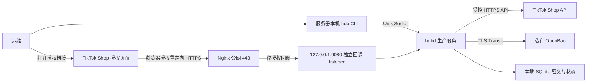

# TT 接入与服务器交付纠偏方案

## 1. 问题与修正目标

用户本轮指出：项目要求对接 TT，没有对外 HTTP 服务就无法接收授权回调；要求给出修正方案。

原需求已正确包含 TikTok Shop 授权与公开回调。错误在于实施只交付了平台无关 fixture 核心和运维演练，尚未补齐 TT 接入，部署说明也没有以用户的完整业务目标作为首要判断。阶段性缩减范围不能替代完整首期验收。

修正后的交付目标：在 Ubuntu 24.04 LTS 上安装生产版服务，以公网 HTTPS 接收 TikTok Shop US、自家店铺应用的授权回调，安全获取并维护 Token，供同一服务器上获授权的 CLI 按完整归属查询业务凭据；完成真实平台联调与部署、备份恢复验收。

本文件是可审阅方案。没有实施代码、修改服务器或 TikTok 控制台，也没有把任何未完成项目改为已完成。

### 证据

- [PRD](prds/prd-third-party-api-key-hub-2026-10-08/prd.md)：FR-5、FR-8、SM-3 要求授权回调和凭据维护；首期管理使用 CLI，不建设 Web 管理界面。回调入口明确不属于 Web 管理界面。
- [架构](architecture/architecture-third-party-api-key-hub-2026-10-08/ARCHITECTURE-SPINE.md)：AD-3、AD-10、AD-14 已要求本地管理与公开回调独立、OpenBao、目标 Linux 部署。
- [Epic 规划](epics.md)：Story 2.1–2.8 已覆盖平台协议、HTTPS、会话、兑换、异常处置、验证、刷新和真实联调。
- [Epic 2 规格](../implementation-artifacts/spec-epic-2-development.md)：仍为 blocked；市场和自用场景已经补齐，平台契约、结果保护和 HTTPS/Linux 实测尚缺。
- 实际代码 `cmd/hubd/daemon.go` 只允许 Linux fixture 启动，`internal/adapters/local/server.go` 只承接 Unix Socket 管理协议；不存在 TT provider 与 callback adapter。

## 2. 推荐部署结构与用户流程

采用已有 Go、SQLite、OpenBao、Linux/systemd 架构；推荐补充 Nginx 作为 HTTPS 入口。Nginx 是本方案新增的部署建议，尚未作为已接受选型写入架构。若目标服务器已有受控 TLS 入口，可复用，但须满足相同路径隔离和日志验收。

`127.0.0.1:9080` 是建议的内部端口，不是当前已经存在的监听。回调路由建议为 `/callbacks/tiktok-shop`，最终写入 CALLBACK-EDGE.md，并与 TT 控制台登记的完整 redirect URL 一致。本文不推定平台参数名、请求方法、签名或 Token 端点；这些按适用的 US Seller 官方协议核实。

用户流程：登记 App 和受控凭据 → CLI 发起授权并取得链接 → 浏览器在 TT 页面登录同意 → TT 重定向到本中心 HTTPS 回调 → 服务兑换授权结果、取得店铺身份和所需凭据 → CLI 查询非敏感完成状态 → 维护外部店铺/品牌/内部店铺映射 → 本机 CLI 取得完整业务凭据。

回调完成页仅显示安全的成功、失败或待处理状态，不展示 Token、授权码、state 或平台原始响应。若平台协议采用直接服务端回调，也由同一独立入口按已核实协议承接。

公网入口只接受契约允许的回调和无秘密健康检查。管理与取密保持 Unix Socket；不把现有 `/v1/operations` 转发到公网。启动独立 mux，未知路径、错误方法和超限输入拒绝；回调连接不获得本机 read/manage 身份。

## 3. 实施顺序、范围和每阶段交付

所有阶段使用同一份需求与验收台账，保留现有本地核心和运维工具。估计整体工作量较高，风险集中在 Seller 协议、外部成功后本地失败、平台刷新资源和真实部署；在核实 App 权限及目标环境前不承诺固定天数。

### P0：纠正状态与实施入口

- 在 README 增加能力表：本地 fixture 已交付；TT 授权、HTTPS 回调、生产密钥后端、生产主机验收分别记录实际状态与证据。
- Epic 1/3 现有完成记录继续只覆盖已经确认的 fixture 范围；恢复 Epic 1 的生产权限、OpenBao 前置工作，再执行 Epic 2，最后补 Epic 3 的生产验收。
- 更新 Epic 2 的阻塞清单：市场 US/自用场景是已确认输入，不再作为未回答问题；未形成的平台契约、安全实现及部署证据列为具体实施任务。
- 本地可推进任务继续完成；真实环境缺口只限制对应验证/上线，不能用一句笼统 blocked 代替整个项目的后续工作。
- 产出：能力/证据表、依赖表、每个真实外部输入的获取方式。此阶段不把原有 Story 或 SQ 门槛提前标为通过。

### P1：核实 TT 协议与补齐生产安全基础

- 对应 Story 1.2/1.3/1.5/1.6/1.7 延期部分与 2.1。
- 核实 TikTok Shop US、自家店铺应用适用的授权链接、redirect URL 约束、回调参数和来源校验、兑换 API、店铺身份/shop_cipher、所需 App 凭据、Token 有效期、刷新轮换、共享刷新资源、明确失效及安全重试条件；记录官方来源、版本与适用范围。不得从 Creator/Affiliate 或通用 OAuth 猜测 Seller 行为。
- 完成 current-credential 与 pending-provider-result 两用途保护契约；实现 OpenBao Transit/AppRole 适配器、续期/重新认证与失败处理，隔离验证跨用途、App、operation、epoch/profile/快照交换拒绝，以及密钥轮换后旧密文解密。
- 实现 root 所有 UID/账户 read/manage 策略与每请求复核，代替目前同服务 UID 自动拥有全部权限的 fixture 规则。
- 增加独立生产配置入口：启动前检查配置、策略、schema、后端身份和密钥；生产不能默认退回 fixture 或使用 fixture.key 保护真实凭据。秘密经受控 credential 文件或 stdin 交付，不放 argv、源码、生产环境变量或聊天。
- 代码落点：`internal/providers/tiktok/`、`internal/adapters/openbao/`、`internal/adapters/local/`、`internal/application/provider.go`、`cmd/hubd/`。
- 产出：`contracts/provider/tiktok-seller-profile.md`、`contracts/secret-protection/PENDING-RESULT-CONTRACT.md`、身份生命周期契约及隔离验证报告、生产配置 schema。
- 通过条件：对应 SQ 子项有可复跑证据，适配器真实对接隔离 OpenBao；只有经核实的能力进入 profile。

### P2：实现独立 HTTPS 回调入口和授权会话

- 对应 Story 2.2/2.3；HTTPS 配置设计和入口隔离探针可在授权兑换前完成。
- 实现独立 callback listener 与安全响应；配置 Nginx 精确路由到该 listener，其他路径拒绝。443 公网可达，9080 仅绑定 loopback，Unix 管理路由不转发；验证证书链、主机名和平台 redirect URL 一致性。
- 默认不采集回调原始访问/错误日志、query、授权码、state 和请求/响应体；如需观测，只从允许字段生成固定路径、状态类别、时间和非敏感 operation ID。代理、应用、监控/APM 全链路验证，不能只关应用日志。
- CLI 以 manage 发起会话，生成至少 256 bit 随机 state，只持久化哈希、App、发起账户、期限和 epoch；返回授权 URL。查询会话仅返回非敏感状态。
- 校验 state、期限、App/profile、epoch 和当前发起者资格；授权 URL 生成成功不等于授权完成。拒绝、超时、重复和迟到回调各有测试。
- 代码落点：`internal/adapters/callback/`、`internal/domain/authorization.go`、`internal/application/authorization.go`、`internal/contract/v1/`、`cmd/hub/response.go`、`cmd/hubd/`。
- 产出：`contracts/linux-runtime/CALLBACK-EDGE.md`、新增 CLI/schema、HTTPS 配置及路径隔离/日志检查报告。
- 通过条件：从独立外部网络能够访问允许入口；公网不能调用管理/取密；无秘密日志。入口探针通过尚不代表 TT 已接入。

### P3：兑换、原子保存与受控异常处置

- 对应 Story 2.4/2.5。会话、操作记录和 schema 迁移必须在真实兑换前落实。
- 平台请求前持久化 operation、快照和状态，使用 App 级排他协调；TT 网络请求不持领域一致性门，结束后复核 epoch、CAS 和 manage。
- 平台结果先保护为完整 pending-provider-result，再在同一事务保存操作状态；符合条件时重新保护为当前目标/type/generation 密文，原子更新全部授权店铺的安装关系及当前值。
- 规范化平台店铺身份，区分中心 external_shop_id、平台 shop ID 与按 App/安装上下文保存的 shop_cipher；不自动猜品牌映射，保持本地停用决定。
- 重复已完成回调只返回安全完成状态，不再次兑换。远端可能成功但本地未提交时保存 protected-result 或 indeterminate，并阻止该 App 普通轮换；重启不自动重放平台兑换。
- 实现 CLI 非敏感操作检查与 manage 显式本地条件提交；条件不符保留阻塞，不能因暂存结果存在而强制覆盖当前值。
- 代码落点：`internal/application/authorization.go`、`provider_operations.go`、`internal/adapters/sqlite/`、`internal/domain/`、`internal/contract/v1/`。
- 通过条件：重复回调、并发新授权、撤权、KMS/数据库失败、多店铺原子性、SIGKILL/重启等测试通过；真实平台重试分类与 profile 一致。

### P4：凭据验证与自动刷新

- 对应 Story 2.6/2.7，只实现 profile 已核实支持的能力。
- 持久化 next_attempt_at 与 refresh_resource_id；同一远端资源的多个安装只领取一次。授权、重授权和刷新共用 App 协调。
- 原子更新所有依赖当前值和版本；刷新失败不延长有效期，明确失效与暂时依赖故障分开处理；后台刷新不解除本地停用，不创建恢复资格。
- 不确定外部副作用进入同一受控恢复流程；重启、时钟不可信、身份续期失败和 Token 轮换均有明确行为。
- 代码落点：`internal/application/validation.go`、`refresh.go`、`internal/domain/refresh.go`、`internal/adapters/sqlite/`、`cmd/hubd/`。
- 通过条件：无人保持 CLI 运行时仍可维护；共享资源、重启调度、迟到结果、失效、停用和不安全重试反例通过；支持的真实刷新另行联调。

### P5：生产包、部署与真实 TT 闭环验收

- 对应 Story 2.8 与 Epic 3 尚未完成的生产交付部分。
- 交付 linux/amd64、linux/arm64 版本归档、校验和、来源清单、生产 systemd unit、生产配置模板、授权策略模板、HTTPS 配置、schema 迁移、安装/升级/回退手册和诊断方法。
- hub/hubd 运行不依赖 Go/Node/Python；部署依赖明确列出目标 systemd、TLS 入口及受控 OpenBao。Python 演练工具作为可选工具注明。
- 安装过程检查账户、目录、权限、已有 schema/数据和迁移前备份；失败保留旧版本与恢复点。回退若涉及不兼容 schema，采用经过验证的备份恢复流程，不能只替换旧二进制。
- 当前 fixture 数据/备份不直接当生产 OpenBao 数据；测试数据隔离。若日后有真实迁移需求，须单独实现受控转换并验证，不复制 fixture.key 宣称迁移完成。
- 在目标 Ubuntu/systemd 上验收非 root 启动、账户撤权、重启、TLS、日志、系统拒绝与告警采集、10 并发且健康 KMS 时 p95≤2s、连续每日一致备份/RPO≤24h、含人工核验的 RTO≤4h，以及恢复默认关闭取密和刷新。
- 真正执行：CLI 发起授权 → TT 页面同意 → 公网回调 → 兑换并保存 → 核对店铺归属 → 本机 CLI 取得完整业务组合 → 用该组合完成 profile 中约定的低影响只读 TT API 检查；再执行支持的刷新并复核当前值与可用性。
- 真实授权、控制台变更和服务器部署需明确外部动作授权；不通过聊天索要 App Secret、Token、SecretID 或私钥。真实环境凭据留在受控主机。
- 两架构运行证据分别记录，模拟环境/WSL 不代替实机证据；未完成项保留未验证。

## 4. 影响与具体文档修订提案

选择直接补齐现有规划；不回滚已验证的本地核心，也不把 TT 授权从首期删除。原 PRD 与架构对回调的要求没有冲突。变更等级 moderate：重新排序执行任务、补齐生产前置和修正交付表达，涉及多个模块；不是根本技术重选。

| 材料 | 现状 | 拟修订 | 理由 |
| --- | --- | --- | --- |
| README 当前状态 | 分别描述 Epic 1/3 的 fixture 交付与延期 | 首行明确“TT 接入尚未完成，现有包仅为 fixture”；增加能力、证据、剩余工作表 | 用户首先看到完整业务目标是否满足 |
| Epic 2 Auto Run Result | 历史 blocked 含目标平台输入缺失，末尾补充该输入已解决 | 保留历史记录；新增当前阻塞表，US/自用标已确认，其余按 P1–P5 路由 | 避免已回答问题继续阻断执行 |
| Epic 1/2/3 规划 | 全量 Story 均有真实生产门槛，fixture 完成另记 | 保留 IDs/验收；追加 P0–P5 顺序和证据状态映射 | 缩减范围完成不自动传播成完整 Epic done |
| PRD FR-5/FR-8/SM-3 | 已要求回调与维护 | 保留原要求，以本方案补充实施和验收追溯 | 修正实现缺失，不弱化原需求 |
| 架构 AD-3/6/9/10/14 | 已有入口隔离、KMS、外部结果恢复、Linux 规则 | 在部署契约明确推荐 Nginx、loopback callback、TLS/日志规则并验证后再更新已采用决定 | 把设计约束落到可执行部署 |
| CLI/密钥契约 | 只覆盖当前 fixture 范围；暂无 pending 完整契约 | 增加授权会话、操作处置、真实 profile 输出与两用途绑定契约 | 防止直接套用 fixture 字段 |
| docs/operations.md / 发布脚本 | fixture 演练与归档 | 增加独立生产手册、unit/config/migration 与 release mode；保留 fixture 手册的实际范围 | 让安装、升级、回退与验收可复核 |

没有发现独立的 UX 设计文档；授权结果页与 CLI 会话状态在本轮补齐，完整 Web 管理后台未纳入该修正方案。若用户希望新增管理后台，应另列功能与认证要求，不与回调入口合并。

## 5. 完成判据与证据台账

任何一个层次都不能替代下一层。拟在 README/发布报告按以下矩阵原位更新，不仅给单一 done 标记。

| 验收层次 | 必须证明什么 | 当前状态 |
| --- | --- | --- |
| 本地演示 | fixture CLI、存储、状态与备份恢复 | 已有范围内交付和验证 |
| TT 代码实现 | Seller adapter、授权会话、独立回调、兑换、异常处置、验证/刷新 | 未实现 |
| HTTPS 部署 | 公网回调可达、证书有效、管理入口不外露、全链路无秘密日志 | 未验收 |
| 生产密钥与账户 | OpenBao/AppRole、两用途保护、root 策略及 read/manage 隔离 | 未交付/未验收 |
| TT 真实接入 | 实际授权、正确店铺身份、取得可用业务凭据、支持的刷新/验证 | 未联调 |
| 生产运维 | Ubuntu/systemd、架构运行、告警采集、连续 RPO、人工 RTO、升级回退 | 未验收 |

完整首期只有 FR-1–12、SM-1–8、保密/归属规则及对应运行目标全部取得证据后才能宣告完成。只有端口开放、链接生成、模拟回调成功、交叉编译或自动秒级恢复演练均不满足此条件。

## 6. 实施交接与外部输入

主实施者负责 P0–P5、契约与代码落点、回归验证和证据维护；架构/安全职责负责两用途绑定与入口权限审查；部署职责负责目标主机、TLS、独立恢复材料和告警；用户参与真实店铺授权及平台当前值/归属核验。角色说明不代表已派发其他代理或已指定外部负责人。

方案进入实施时，先完成 P0 和 P1 的调查/契约/可执行测试，不重复询问已确认的 US、自用场景；缺少以下环境资料时继续不依赖它们的本地工作，并只列具体缺口：

- 目标服务器：发行版、CPU 架构、现有入口/证书和部署访问方式。
- 回调域名与完整 URL、DNS/公网可达性、TT 控制台允许的 redirect URL 配置方式。
- TT 应用实际类别、Seller 授权/API 权限和适用官方文档入口；必要时提供去敏控制台信息。
- 受控隔离/生产 OpenBao 地址、CA、身份交付与恢复材料管理方式；秘密不进入文档或聊天。
- 真实 TT 授权/刷新测试和目标服务器变更的外部动作授权。

方案只为上述原需求的修正，不在此轮派发实施或执行外部动作。

### 纠偏检查清单结果

- [x] 1.1–1.3：触发为 Story 2.2/2.4 未交付、部署回答没有突出完整 TT 目标；已收集 PRD、规划、blocked 记录和实际代码证据。
- [x] 2.1–2.5：现有 Epic 仍适用；按生产前置 → Epic 2 → Epic 3 生产验收排序，不增加或删除 Epic。
- [x] 3.1–3.4：PRD/架构原要求正确；修订交付状态、生产实现、部署和验收追溯；UX 独立材料不存在。
- [x] 4.1/4.4：推荐直接补齐原计划，工作量较高，风险可通过分阶段测试与真实联调收敛。
- [N/A] 4.2/4.3：回滚核心和删除 TT 需求不解决原目标；不采用。
- [x] 5.1–5.5、6.1–6.2：问题、影响、具体修订、实施顺序、责任和完成标准已形成方案。
- [!] 6.3/6.5：方案供用户修正；实施交接与真实外部操作授权未完成，未声称已完成。
- [N/A] 6.4：未发现 sprint-status.yaml；此轮不虚构状态文件，也不把候选修订标为已批准。
