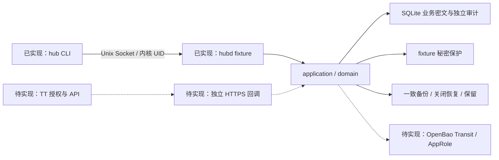

# 项目盘点：2026-10-10

## 1. 当前判断

项目已经交付可测试的本地手工凭据核心和 fixture 备份恢复能力，但首期最关键的 TikTok Shop 授权与维护闭环尚未实现，生产密钥、账户策略和服务器部署也未通过验收。当前阶段是**已有核心实现，正在补齐平台接入与生产基础**。

需求、架构和规划已形成基线，无须从零重写。接下来应围绕完整首期目标安排工作：生产安全基础与 Seller 协议 → 回调和授权兑换 → 异常处置与刷新 → 真实平台、部署及恢复验收。

本盘点依据当前 master 的代码、规划与交付记录，并重跑基础验证。既存的 [TT 纠偏方案](../_bmad-output/planning-artifacts/sprint-change-proposal-2026-10-10.md) 仍为 `proposed`，不能视为已批准的新增选型或已经实施的能力。本报告只新增盘点文档，不变更需求、Story 状态或部署配置。

## 2. 产品目标与边界

**交付目标：** 运维在 Linux 服务主机通过 CLI 登记 App、维护品牌/店铺归属、导入凭据或发起 TikTok Shop 授权；服务安全保存并维护当前值；获授权的业务脚本按品牌、内部店铺或外部店铺取得完整、可用的业务凭据。

首期范围为 FR-1 至 FR-12。市场与使用场景已由现有记录确认是 TikTok Shop US、自家店铺使用；实际 App 类别、已授 Seller 权限及适用官方协议仍需核实，不能把使用场景当作已验证的平台 profile。

已采用的边界：

- 管理和取密在服务主机通过 Unix Socket，身份来自 Linux 内核，并按账户策略授予 read/manage。
- 公开 HTTPS 承接平台授权回调；回调不能取得本机管理或取密资格。首期管理界面为 CLI。
- 外部店铺归属品牌，品牌与内部店铺一对一；App 与外部店铺通过安装授权关联，支持多对多。
- 每个目标/类型只有一个当前秘密值；版本、确认/验证、有效期、停用及恢复资格分别判定。
- 取密要求完整归属和完整业务组合，任何必需项失败都不输出部分秘密；刷新专用值不进入业务输出。
- 生产密钥保护采用 OpenBao Transit；Vaultwarden 自动同步和平台内查看权限属于后续范围。

产品基线见 [SPEC](../_bmad-output/specs/spec-third-party-api-key-hub/SPEC.md)、[PRD](../_bmad-output/planning-artifacts/prds/prd-third-party-api-key-hub-2026-10-08/prd.md) 及其 companions。

## 3. 需求与实现对照

“本地已交付”均指虚构 profile 和 fixture 保护后端，不表示 TikTok 或生产验收通过。

| 需求 | 当前实现 | 尚缺的完整首期证据或功能 |
| --- | --- | --- |
| FR-1 平台/App 登记 | fixture 登记、唯一性、列表 | 真实 TikTok profile 与字段用途 |
| FR-2 安装授权关联 | 手工建立、查询 App/店铺关联 | 授权结果驱动的安装更新、多店铺原子提交 |
| FR-3 外部店铺/品牌归属 | 维护、解除、冲突拒绝、取密归属检查 | 生产环境回归及真实店铺身份核对 |
| FR-4 品牌/内部店铺映射 | 一对一维护、解除、缺链拒绝 | 生产环境回归 |
| FR-5 店铺授权 | 尚无真实授权会话、回调和兑换 | Seller 协议、会话、安全回调、幂等兑换与真实授权 |
| FR-6 手工导入 | stdin/隐藏 TTY、显式替换、App/shop 导入 | TikTok 必需字段、生产账户/KMS 基线及人工验收 |
| FR-7 保存与验证 | 当前值密文、generation、人工确认、版本化失效标记 | OpenBao、真实平台验证、类型化暂时失败和迟到结果 |
| FR-8 自动维护/停用恢复 | 本地停用、替换后显式恢复及版本规则 | 真实自动刷新、共享资源调度、持久化不确定结果处理 |
| FR-9 按归属取密 | 三种定位路径、完整组合、整体失败 | 真实 Seller 业务组合及健康生产 KMS 验收 |
| FR-10 机器输出 | contract/v1、严格 JSON、27 操作、错误/退出码、安全输出 | 授权、平台操作处置、验证/刷新契约和 profile 输出白名单 |
| FR-11 Linux 账户权限 | Unix SO_PEERCRED；fixture 仅同服务 UID 获 read/manage | root 所有 UID/账户策略、read/manage 分离、撤权及实际主机权限 |
| FR-12 非敏感审计 | 独立审计、检索、保留边界、缺口和安全告警枚举 | 系统连接拒绝、回调 edge 及真实告警采集链路、一年保留部署 |

生产启动目前被主动拒绝：`cmd/hubd/daemon.go` 要求 `--fixture` 与 Linux。`compose.yaml` 使用 `network_mode: none`，现有服务只在 Unix Socket 上提供协议。因此，当前镜像不能接收公网 TT 回调，也不能通过出站网络访问 TT/OpenBao；生产部署须有独立配置与经过验证的网络边界。

`internal/application/provider.go` 目前只有可信静态凭据定义，公开 fixture 组合是 App `client_secret` + shop `shop_token`。它还没有 TikTok 网络适配器，不能把 ProviderRegistry 的存在当作平台接入完成。

## 4. 技术结构与可复用资产

当前技术栈是 Go 1.27.2、modernc SQLite 1.60.1、Linux Unix Socket。Node package.json 只有 `node --version` 检查脚本；服务运行依赖从 Go 模块与部署文件判断。Go 升级已有架构补丁决策，旧 Story 中 1.27.1 属于需同步的历史描述。

| 位置 | 职责与复用价值 |
| --- | --- |
| `cmd/hub/` | stdin/TTY、IPC 客户端、完整读取与安全输出验证 |
| `cmd/hubd/` | fixture 启动、实例锁、存储准入、Unix listener、关闭与每日维护 |
| `internal/domain/` | App/店铺/品牌/安装、版本化凭据、可用性和恢复资格 |
| `internal/application/` | 唯一业务变更入口、完整查询、权限复核、一致性门、CAS、审计 |
| `internal/contract/v1/` | 共享 DTO、字段出现性、输入边界与运维操作契约 |
| `internal/adapters/sqlite/` | 业务/审计持久化、准入、迁移、恢复日志检查、快照 |
| `internal/adapters/protector/` | fixture 保护及当前值端口；生产和结果包保护仍需扩展 |
| `internal/adapters/backup/` | 双库一致备份、manifest/hash、原子发布、保留、关闭恢复 |
| `scripts/`、`deploy/` | 契约生成、可复现 fixture 归档、演练/容量工具、fixture systemd 样例 |

数据库当前按实体保存 JSON record，全状态读取/事务保存，revision CAS 防覆盖，业务唯一性主要由用例执行。原生产架构要求数据库唯一索引/外键共同约束关系，两者还需要在生产化时对齐；已有交付边界已承认这一差异。不能直接宣称生产关系约束和生产容量已经满足。

## 5. Epic 与 BMad 阶段

| Epic/阶段 | 实际状态 | 证据入口 |
| --- | --- | --- |
| 产品简报、PRD、架构、SPEC | 已定稿；文档 final 表示基线确认 | README 中的 companions |
| Epic/Story 拆分 | 3 Epic、34 条规划；18/8/8 | epics.md、CE-VALIDATION.md |
| Epic 1 | 本地手工核心交付；完整生产 Epic 尚未完成 | epic-1-local-delivery.md |
| Epic 2 | 已有开发规格和准备上下文；授权/回调/刷新尚未实现 | spec-epic-2-development.md |
| Epic 3 | 平台无关运维核心交付，并完成后续存储/容量修复；生产验收未完成 | epic-3-validation.md、review-remediation-validation.md |
| Sprint tracking | 未发现 sprint-status.yaml | 当前交付记录分散于规划和 implementation-artifacts |
| 纠偏 | 已有 2026-10-10 proposed 方案 | sprint-change-proposal-2026-10-10.md |

需要整理的状态问题：

1. `epics.md`、`CE-VALIDATION.md` 仍写“所有任务尚未执行”或“34 条规划均未执行”，并推荐从 1.1/1.2 开始。这些反映 10-08 的规划评估，不能作为 10-10 的实现进度。
2. `bmad-build-auto-result-epic-3.md` 的 blocked 记录是早期工作树/分支路由失败；后续交付和合并已发生，当前 Epic 3 应从较新的 validation 读取。
3. Epic 2 原阻塞中的市场/使用场景已解决；其余契约和实现应拆成可推进任务，外部环境只阻塞相应的真实验证。
4. 架构 Stack 附近仍有“业务尚无代码”；Go 补丁版本虽已更新，部分 Story 的旧版本字面量尚未同步。
5. 仓库未发现根 AGENTS.md 文件，也未发现 `.github/` CI 配置。当前会话已有用户提供的指导；后续可把核验过的项目命令、fixture/生产边界与文档读取优先级写入项目入口。

保留旧报告的历史证据，在当前入口标注其日期和替代关系；不把完整 Story 批量改为 done。Sprint 状态应记录剩余工作，同时链接“本地范围已交付”和“生产验收未通过”两种证据。

## 6. 本轮验证与证据边界

2026-10-10 本轮实际执行：

| 检查 | 结果 | 范围 |
| --- | --- | --- |
| Docker Go 1.27.2 `go test -count=1 -race -coverpkg=./... ./...` | 退出 0；9 个有测试的包通过，无竞态报告；buildinfo 无测试 | 当前 Linux fixture 核心；仓库只读挂载、禁网；未启用 opt-in 历史容量测量 |
| Docker `go vet ./...` | 退出 0 | 当前 Go 源码静态检查 |
| Python unittest discover | 12 测试通过 | 运维工具回归 |
| 契约生成/校验 | 27 操作、54 样例、10 回归通过 | 输出至临时目录；9 份生成 JSON 与仓库版本逐字节一致 |
| `git diff --check` | 通过 | 盘点前工作树检查；新增报告后再次核验 |

已有较新 [审查修复验证](../_bmad-output/implementation-artifacts/review-remediation-validation.md) 报告：合并语句覆盖率 81.7%，vet/govulncheck 通过，fixture 恢复演练 14 项通过，150 包明确规模的历史容量通过。本轮未重新执行漏洞扫描、构建归档、恢复/容量演练或生产验收；这些仍标为历史证据。

特别保留以下限制：

- 历史 CLI 容量测量整体 p95 约 1.967s，接近 2s 目标；它使用 fixture，并不能证明真实 KMS 或不同主机负载下的性能。
- 当前构建支持两架构；arm64 交叉编译/历史模拟运行不能替代 Ubuntu arm64 实机验收。
- fixture 自动恢复的秒级耗时不能作为包含人工核验的生产 RTO，模拟 RPO 不能作为连续每日生产备份证据。
- `recovery.open` 的全部版本引用受 1MiB 请求限制；大规模恢复复核仍需评估。
- SQLite 原生恢复日志校验不等同于独立全状态认证，不能保证识别所有位损坏或恶意重写。

## 7. 当前风险与下一步顺序

| 优先级 | 问题 | 影响与完成条件 |
| --- | --- | --- |
| P0 | 产品目标与进度入口脱节 | 容易继续做 fixture 运维却误判 TT 完成；建立当前能力/证据矩阵和剩余任务入口 |
| P1 | 生产保护和账户策略缺失 | 尚不能处理真实凭据；实现 Transit/AppRole、两用途绑定与 root 管理的 read/manage 策略，并取隔离实证 |
| P1 | Seller 契约、授权和回调缺失 | 首期业务闭环无法完成；先核实官方适用协议，再实现会话、独立入口、兑换、原子提交 |
| P1 | 外部成功/本地失败恢复未实现 | 重试可能覆盖当前值或重复副作用；持久操作、受保护结果和显式条件提交必须与兑换一起交付 |
| P2 | 持续维护缺失 | 授权之后仍无法证明长期可用；实现 profile 支持的验证/刷新、共享资源调度与重启规则 |
| P2 | 生产数据库/部署契约未落实 | fixture 结构和 unit 不满足已采用生产架构；评估关系 schema/迁移，形成生产包、账户、TLS、采集配置 |
| P2 | 缺真实性能与恢复证据 | 无法宣告首期可发布；完成 Linux/KMS/TT、双架构、连续 RPO、人工 RTO 验收 |

建议按以下交付节点推进；这是盘点建议，不替代需求或新增选型批准：

1. **整理当前状态。** 以本报告的能力矩阵更新 README 的入口；保留原 Story 编号，把延期生产项和 Epic 2 可执行项列清；处理旧 blocked/final 的误导文字。现有 proposed 纠偏方案供确认和修订。
2. **并行准备协议与生产基础。** 核实 TikTok Shop US Seller profile；完成 current-credential 与 pending-provider-result 的保护契约、OpenBao/AppRole 实现、账户策略，以及平台操作所需 schema/迁移设计。这里的“并行”指任务可独立安排，不代表本轮派发了代理。
3. **交付首次授权闭环。** CLI 发起/查状态、独立 callback listener、HTTPS 部署边界、state/期限/epoch 校验、兑换、多店铺原子提交、幂等与不确定结果处置。Nginx、loopback 端口和路径仍是纠偏方案建议，具体选型由部署契约决定。
4. **交付持续维护。** 仅实现官方核实支持的验证和刷新，处理共享刷新资源、撤权、停用、过期、重启和迟到结果。
5. **交付真实运行证据。** 受控实际授权 → 回调 → 保存 → 核对映射 → 本机 CLI 查询 → 约定只读业务 API 验证 → 支持的刷新；然后补部署、性能、告警、备份恢复、安装升级/回退及双架构运行。

本地契约、单元/集成测试、适配器和部署模板可以持续推进。真实 TT 操作、控制台配置和服务器变更需要其对应的外部动作授权；缺少某个环境不应阻断无依赖的本地准备工作。

## 8. 外部输入与执行边界

不重复询问已确认的 US/自用场景。后续实际联调需要：目标主机架构/发行版与访问方式；回调域名、证书、DNS 和 redirect URL；去敏的 App 类别/Seller 权限/适用文档入口；受控 OpenBao 地址、CA、身份交付及恢复材料管理方式；具体真实测试/部署授权。实际秘密留在受控主机，不进入聊天或项目文档。

## 9. BMad 路由建议

先列可选维护，再列下一项必需的开发准备。建议在新聊天中执行相应技能，并引用本报告和 SPEC companions。

| 顺序 | 菜单与技能 | 用法与本项目适用范围 |
| --- | --- | --- |
| 可选 | [PC] Project Context — `bmad-project-context` | setup/refresh：形成根项目入口，记录已核验命令、fixture/生产边界和文档优先级 |
| 可选 | [CC] Correct Course — `bmad-correct-course` | 以既有 2026-10-10 方案作输入，完成修订和当前状态对齐；无需重新创建同一份方案 |
| 下一项必需准备 | [SP] Sprint Planning — `bmad-sprint-planning` | 检查剩余任务适用的契约/证据，生成或修复状态台账；未满足门槛的任务保留缺口，不批量 ready-for-dev |
| 随后实施 | [BD] Build — `bmad-build` | 先处理范围明确的生产基础与 Seller 契约任务，再按依赖实现授权闭环；完成节点 2 后才能放行依赖其证据的任务 |

PRD 与架构已有基线；仅在实际范围/行为/选型发生变化时分别用 [PRD] `bmad-prd` 与 [CA] `bmad-architecture` 更新。当前缺口主要是落实既有契约及其证据。

## 10. 主要依据

- [本地核心交付边界](../_bmad-output/implementation-artifacts/epic-1-local-delivery.md)
- [Epic 2 开发规格与已补齐输入](../_bmad-output/implementation-artifacts/spec-epic-2-development.md)
- [Epic 3 交付及历史证据边界](../_bmad-output/implementation-artifacts/epic-3-validation.md)
- [较新审查修复与容量验证](../_bmad-output/implementation-artifacts/review-remediation-validation.md)
- [完整 Epic/Story 规划](../_bmad-output/planning-artifacts/epics.md)
- [历史 CE 校验](../_bmad-output/planning-artifacts/CE-VALIDATION.md)
- [架构契约及 Go 补丁决定](../_bmad-output/planning-artifacts/architecture/architecture-third-party-api-key-hub-2026-10-08/ARCHITECTURE-SPINE.md)
- [运行手册](operations.md)
- 当前 `cmd/`、`internal/`、`scripts/`、`deploy/`、`go.mod` 和 `compose.yaml`。
